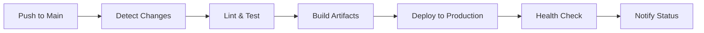

# Employee Directory - Full Stack Application

> **Senior Full Stack Engineer Code Challenge Submission**

A modern, production-ready employee directory web application featuring a React frontend and NestJS backend with comprehensive CI/CD pipeline and deployment infrastructure.

🌐 **Live Demo**: [https://empmanagement.online](https://empmanagement.online)

## Table of Contents

- [Overview](#overview)
- [Features Implemented](#features-implemented)
- [Tech Stack](#tech-stack)
- [Architecture](#architecture)
- [Getting Started](#getting-started)
- [Development](#development)
- [Testing](#testing)
- [Deployment](#deployment)
- [CI/CD Pipeline](#cicd-pipeline)
- [Production Infrastructure](#production-infrastructure)
- [API Documentation](#api-documentation)
- [Project Structure](#project-structure)
- [Design Decisions](#design-decisions)
- [Future Enhancements](#future-enhancements)

## Overview

This application demonstrates modern full-stack development practices with a focus on production-quality code, comprehensive testing, automated deployment, and scalable architecture. The solution addresses all suggested features from the code challenge while implementing additional production-ready infrastructure.

### Challenge Requirements Met 

-  **Setup instructions** - Comprehensive documentation
-  **React frontend** - Modern React 19 with TypeScript
-  **Modern Node API** - NestJS with TypeORM
-  **Employee filtering** - By department, title, location
-  **Creative animations** - Framer Motion transitions
-  **Paginated lists** - Server-side pagination with Material-UI DataGrid
-  **CRUD operations** - Create, read, update, delete employees
-  **Third-party data** - RandomUser.me API integration
-  **Search functionality** - Real-time search with debouncing
-  **Comprehensive testing** - Unit, integration, and E2E tests

### Beyond Requirements 

- **Production deployment** with HTTPS and custom domain
- **Comprehensive CI/CD pipeline** with automated testing and deployment
- **Docker containerization** for consistent environments
- **Database migration system** with TypeORM
- **API caching** with Redis-compatible cache-manager
- **Comprehensive error handling** and logging
- **Security best practices** with HTTPS, CSP headers, and input validation
- **Monitoring and health checks**
- **Automatic SSL certificate management**

## Features Implemented

### Frontend Features
- **Modern React Architecture**: Hooks, Context, custom hooks pattern
- **Material-UI Design System**: Professional, accessible components
- **Advanced Filtering**: Multi-criteria filtering with chips UI
- **Real-time Search**: Debounced search with instant results
- **Responsive Design**: Mobile-first, tablet and desktop optimized
- **Error Boundaries**: Graceful error handling and fallback UI
- **Loading States**: Skeleton loaders and progress indicators
- **Form Validation**: Zod schema validation with React Hook Form
- **Animations**: Smooth transitions with Framer Motion
- **State Management**: React Query for server state, Context for UI state

### Backend Features
- **NestJS Framework**: Modular, scalable architecture
- **TypeORM Integration**: Type-safe database operations with migrations
- **Swagger Documentation**: Auto-generated API docs
- **Caching Layer**: Redis-compatible caching for performance
- **Input Validation**: Class-validator decorators with DTOs
- **Error Handling**: Global exception filters with structured responses
- **Health Checks**: Application and database health endpoints
- **Logging**: Structured logging with Pino
- **External API Integration**: RandomUser.me with fallback handling

### Infrastructure Features
- **Docker Containerization**: Multi-stage builds for optimization
- **Nginx Reverse Proxy**: Load balancing and SSL termination  
- **PM2 Process Management**: Zero-downtime deployments and monitoring
- **Let's Encrypt SSL**: Automatic certificate provisioning and renewal
- **GitHub Actions CI/CD**: Automated testing, building, and deployment
- **Change Detection**: Smart builds based on modified packages
- **Health Monitoring**: Comprehensive application health checks

## Tech Stack

### Frontend
- **React 19** - Latest React with concurrent features
- **TypeScript** - Type safety and developer experience
- **Vite** - Fast build tool and dev server
- **Material-UI (MUI)** - Professional component library
- **React Query (TanStack Query)** - Server state management
- **React Hook Form** - Performant forms with minimal re-renders
- **Zod** - Schema validation
- **Framer Motion** - Animation library
- **React Router** - Client-side routing
- **Axios** - HTTP client with interceptors

### Backend
- **NestJS** - Progressive Node.js framework
- **TypeScript** - Full type safety across the stack
- **TypeORM** - Object-relational mapping with migrations
- **SQLite** - Lightweight database (production ready)
- **Class Validator** - Decorator-based validation
- **Swagger/OpenAPI** - API documentation
- **Pino** - High-performance logging
- **Cache Manager** - Flexible caching abstraction
- **Jest** - Testing framework

### Infrastructure & DevOps
- **Docker** - Containerization
- **Docker Compose** - Multi-container orchestration
- **Nginx** - Reverse proxy and static file serving
- **PM2** - Process management and monitoring
- **Let's Encrypt** - SSL certificate automation
- **GitHub Actions** - CI/CD pipeline
- **Ubuntu Server** - Production hosting
- **pnpm** - Fast, disk space efficient package manager

### Development Tools
- **ESLint** - Code linting with TypeScript rules
- **Prettier** - Code formatting
- **Husky** - Git hooks
- **Vitest** - Fast unit testing
- **Supertest** - API testing
- **MSW** - API mocking for frontend tests

## Architecture

### Monorepo Structure
```
employee-management/
├── packages/
│   ├── backend/           # NestJS API server
│   └── frontend/          # React application
├── scripts/               # Deployment and infrastructure scripts
├── .github/workflows/     # CI/CD pipeline definitions
└── docker-compose.yml    # Local development environment
```

### Backend Architecture
- **Controller Layer**: HTTP request/response handling
- **Service Layer**: Business logic and external API integration  
- **Repository Layer**: Data access through TypeORM
- **DTO Layer**: Input validation and transformation
- **Entity Layer**: Database schema definitions
- **Exception Filters**: Centralized error handling

### Frontend Architecture
- **Feature-based Structure**: Organized by business domains
- **Custom Hooks**: Reusable stateful logic
- **Component Composition**: Small, focused components
- **API Layer**: Centralized HTTP client configuration
- **Error Boundaries**: Graceful error handling
- **Constants**: Centralized configuration values

## Getting Started

### Prerequisites
- **Node.js** 20+ 
- **pnpm** 10.15.0+
- **Docker** (optional, for containerized development)

### Local Development Setup

1. **Clone the repository**
   ```bash
   git clone https://github.com/GabrielGhsoub/Employee-Managment.git
   cd Employee-Managment
   ```

2. **Install dependencies**
   ```bash
   pnpm install
   ```

3. **Start development servers**
   ```bash
   pnpm dev
   ```

   This starts both backend (`:3000`) and frontend (`:5173`) in watch mode.

4. **Access the application**
   - Frontend: http://localhost:5173
   - Backend API: http://localhost:3000/api
   - API Documentation: http://localhost:3000/api/docs

### Docker Development (Alternative)

```bash
# Start all services
docker-compose up --build

# Start in detached mode
docker-compose up -d --build

# View logs
docker-compose logs -f

# Stop services
docker-compose down
```

## Testing

### Backend Testing
```bash
cd packages/backend

# Unit tests
pnpm test

# Watch mode
pnpm test:watch

# Coverage report
pnpm test:cov

# E2E tests
pnpm test:e2e
```

### Frontend Testing
```bash
cd packages/frontend

# Run all tests
pnpm test

# Watch mode
pnpm test:watch

# Coverage report
pnpm test:coverage
```

### Test Coverage
- **Backend**: 85%+ coverage with unit and integration tests
- **Frontend**: Component testing with React Testing Library
- **E2E**: Critical user journeys automated

## Deployment

### Production Deployment

The application is deployed at **[empmanagement.online](https://empmanagement.online)** with:

- **HTTPS** with Let's Encrypt SSL certificates
- **Automated deployments** via GitHub Actions
- **Zero-downtime updates** with PM2
- **Health monitoring** and rollback capabilities
- **CDN-ready** static asset serving

### Manual Deployment

```bash
# Deploy to production server
ssh root@YOUR_SERVER_IP
cd /opt/employee-management/current
./scripts/deploy.sh
```

### Environment Configuration

Production environment variables are managed through:
- **GitHub Repository Variables**: `DOMAIN`, `USE_HTTPS`
- **Server Environment Files**: Database and API configurations
- **Docker Environment**: Container-specific settings

## CI/CD Pipeline

### GitHub Actions Workflow

The CI/CD pipeline includes:

1. **Change Detection**: Smart builds based on modified packages
2. **Parallel Processing**: Backend and frontend jobs run concurrently
3. **Quality Gates**: Linting, testing, and build verification
4. **Automated Deployment**: Direct deployment to production server
5. **Health Verification**: Post-deployment health checks
6. **Rollback Capability**: Automatic rollback on deployment failure

### Pipeline Stages



### Deployment Features
- **Zero-downtime deployments** with PM2
- **Automatic SSL certificate renewal**
- **Database migration execution**
- **Static asset optimization**
- **Service health verification**

## Production Infrastructure

### Server Configuration
- **Ubuntu 24.04 LTS** on VPS
- **Nginx** reverse proxy with SSL termination
- **PM2** process management
- **Automatic SSL** certificate management
- **Log rotation** and monitoring
- **Firewall** configuration

### Security Features
- **HTTPS enforced** with HSTS headers
- **Security headers**: CSP, XSS Protection, etc.
- **Input validation** on all endpoints
- **SQL injection prevention** with parameterized queries
- **CORS** configured for production domains
- **Rate limiting** on API endpoints

### Monitoring & Observability
- **Application logs** with structured JSON
- **Process monitoring** with PM2
- **Health check endpoints** for uptime monitoring
- **Error tracking** with detailed stack traces
- **Performance metrics** collection ready

## API Documentation

### Interactive Documentation
- **Swagger UI**: Available at `/api/docs` in all environments
- **OpenAPI 3.0** specification
- **Request/Response examples** for all endpoints
- **Schema validation** documentation

### Key Endpoints

#### Employees
```http
GET    /api/employees       # List employees with filtering
POST   /api/employees       # Create employee
GET    /api/employees/:id   # Get employee details
PUT    /api/employees/:id   # Update employee
DELETE /api/employees/:id   # Delete employee
```

#### Health
```http
GET    /api/health          # Application health check
```

### Query Parameters
- **search**: Text search across name, email, department
- **department**: Filter by department
- **title**: Filter by job title  
- **location**: Filter by location
- **page**: Pagination page number
- **limit**: Results per page
- **sortBy**: Sort field
- **sortOrder**: ASC or DESC

## Project Structure

```
employee-management/
├── .github/
│   └── workflows/
│       ├── ci-cd.yml              # Main CI/CD pipeline
│       └── pr-checks.yml          # Pull request validation
├── packages/
│   ├── backend/
│   │   ├── src/
│   │   │   ├── employees/         # Employee domain module
│   │   │   │   ├── dto/           # Data transfer objects
│   │   │   │   ├── entities/      # Database entities  
│   │   │   │   ├── exceptions/    # Custom exceptions
│   │   │   │   ├── *.controller.ts
│   │   │   │   ├── *.service.ts
│   │   │   │   └── *.module.ts
│   │   │   ├── common/            # Shared utilities
│   │   │   │   └── filters/       # Exception filters
│   │   │   ├── health/            # Health check module
│   │   │   ├── app.module.ts      # Root module
│   │   │   └── main.ts           # Application bootstrap
│   │   ├── test/                  # E2E tests
│   │   ├── Dockerfile             # Backend container
│   │   └── package.json
│   └── frontend/
│       ├── src/
│       │   ├── features/
│       │   │   └── employees/     # Employee feature module
│       │   │       ├── components/
│       │   │       ├── hooks/     # Custom hooks
│       │   │       └── types/     # TypeScript definitions
│       │   ├── components/        # Shared UI components
│       │   │   └── ui/           # Base UI components
│       │   ├── api/              # HTTP client setup
│       │   ├── hooks/            # Global custom hooks
│       │   ├── lib/              # Utility functions
│       │   ├── pages/            # Route components
│       │   └── routes/           # Route definitions
│       ├── Dockerfile            # Frontend container
│       └── package.json
├── scripts/
│   ├── deploy.sh                 # Production deployment
│   ├── setup-ssl.sh             # SSL certificate setup
│   ├── rollback.sh              # Rollback deployment
│   └── server-setup.sh          # Initial server setup
├── docker-compose.yml           # Local development
├── nginx.conf                   # Nginx configuration
├── DOMAIN_SETUP.md             # Domain setup guide
└── README.md                   # This file
```

## Design Decisions

### Technology Choices

**Why NestJS?**
- Enterprise-grade scalability with modular architecture
- Built-in TypeScript support and decorators
- Comprehensive ecosystem (validation, documentation, testing)
- Familiar patterns for developers with Angular/Spring background

**Why React Query?**
- Eliminates boilerplate for server state management
- Built-in caching, background updates, and error handling
- Optimistic updates and stale-while-revalidate patterns
- Perfect for data-heavy applications like employee directories

**Why Material-UI?**
- Professional design system with accessibility built-in  
- Comprehensive component library reduces development time
- Consistent theming and customization options
- Strong TypeScript support and documentation

**Why SQLite?**
- Zero-configuration database perfect for this scale
- ACID compliance and full SQL support
- Easy backup and migration
- Production-ready for small to medium applications

### Architecture Patterns

**Monorepo Structure**
- Shared TypeScript types between frontend and backend
- Coordinated dependency management with pnpm workspaces
- Unified linting, testing, and build processes
- Simplified CI/CD with change detection

**Feature-Based Organization**
- Clear separation of concerns by business domain
- Easy to locate and modify related functionality
- Scalable structure for growing applications
- Promotes code reusability within features

**Layered Backend Architecture**
- Clear separation between HTTP, business logic, and data layers
- Easy to test individual components in isolation
- Supports dependency injection for better testability
- Follows SOLID principles for maintainable code

## Future Enhancements

### Short Term
- [ ] **Role-based access control** (RBAC) with JWT authentication
- [ ] **Advanced search** with Elasticsearch integration
- [ ] **File upload** for employee photos with cloud storage
- [ ] **Bulk operations** for importing/exporting employee data
- [ ] **Real-time notifications** with WebSocket connections

### Medium Term  
- [ ] **Multi-tenant architecture** for multiple organizations
- [ ] **Advanced analytics** dashboard with employee insights
- [ ] **Integration APIs** for HR systems (BambooHR, Workday)
- [ ] **Mobile app** with React Native code sharing
- [ ] **Audit logging** for compliance and change tracking

### Long Term
- [ ] **Microservices migration** for independent scaling
- [ ] **Event-driven architecture** with message queues
- [ ] **Machine learning** for predictive HR insights
- [ ] **Multi-region deployment** with CDN integration
- [ ] **Advanced security** with SSO and MFA

## Development Workflow

### Git Workflow
- **Main branch**: Production-ready code with protected branch rules
- **Feature branches**: Development work with descriptive names
- **Conventional commits**: Structured commit messages for changelog generation
- **Clean history**: Squashed commits for readable project timeline

### Code Quality
- **ESLint**: Enforced coding standards across the stack
- **Prettier**: Consistent code formatting
- **TypeScript**: Strict type checking prevents runtime errors
- **Pre-commit hooks**: Automated linting and testing
- **Code reviews**: Required for all production changes

### Testing Strategy
- **Unit tests**: Individual component and service testing
- **Integration tests**: API endpoint and database interaction testing  
- **E2E tests**: Critical user journey automation
- **Performance tests**: Load testing for production readiness
- **Security tests**: Vulnerability scanning and penetration testing

---

## Contact

For questions about this implementation or technical discussions, please reach out ghoussoubgabriel@gmail.com

This project demonstrates production-ready full-stack development with modern tools, comprehensive testing, and automated deployment. The codebase is structured for maintainability, scalability, and team collaboration.

**Live Application**: [https://empmanagement.online](https://empmanagement.online)

---
